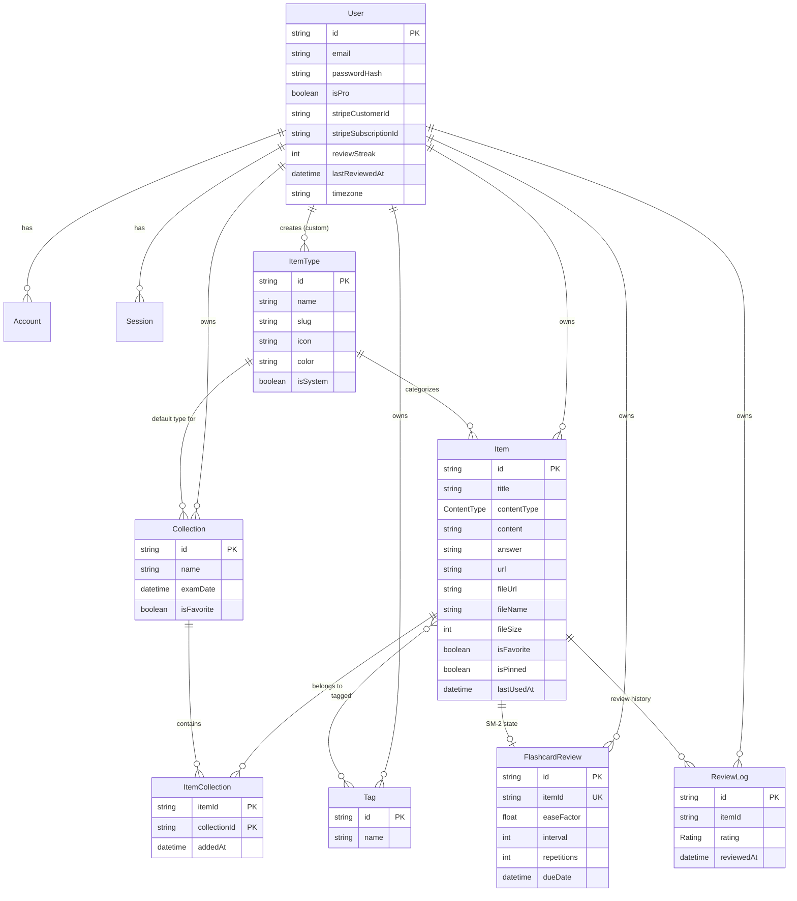
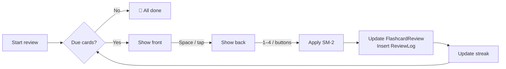
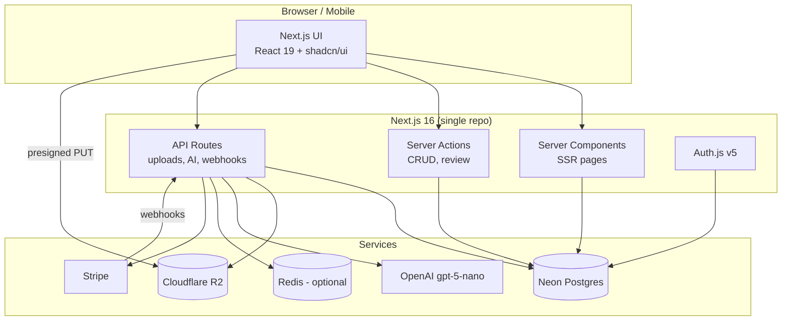

# StudyStash — Project Overview

> One fast, searchable, AI-enhanced hub for all your study material, with built-in spaced-repetition flashcard review.

---

## Table of Contents

1. [Problem](#1-problem)
2. [Target Users](#2-target-users)
3. [Features](#3-features)
4. [Data Model](#4-data-model)
5. [Prisma Schema](#5-prisma-schema)
6. [Spaced Repetition (SM-2)](#6-spaced-repetition-sm-2)
7. [Tech Stack](#7-tech-stack)
8. [Architecture](#8-architecture)
9. [Routes](#9-routes)
10. [Monetization](#10-monetization)
11. [UI/UX](#11-uiux)
12. [Development Rules](#12-development-rules)
13. [Open Questions](#13-open-questions)
14. [Reference Links](#14-reference-links)

---

## 1. Problem

Students and self-learners keep their study material scattered:

| Material               | Where it usually lives                     |
| ---------------------- | ------------------------------------------ |
| Lecture notes          | Notion, Google Docs, phone photos of paper |
| Flashcards             | A separate app (Anki, Quizlet)             |
| Formulas & definitions | Screenshots                                |
| Slides & PDFs          | Buried in Downloads                        |
| Videos & articles      | Browser bookmarks                          |
| Past exam questions    | Random folders                             |
| AI explanations        | Lost when the chat ends                    |

The result is constant context switching, lost knowledge and inefficient revision.

**StudyStash** brings all of it into one place: fast to capture, easy to find, and built for revision.

---

## 2. Target Users

| Persona                             | Needs                                                                                                        |
| ----------------------------------- | ------------------------------------------------------------------------------------------------------------ |
| **University student**              | One place per course for notes, slides, formulas and exam prep                                               |
| **High school / exam-prep student** | Flashcards and quick revision for standardized exams (SAT, IELTS, etc.)                                      |
| **Self-learner**                    | Saves videos, articles, notes and practice questions while learning a skill (programming, languages, design) |
| **Tutor / teacher**                 | Organizes explanations, worked examples and question banks to share with students                            |

---

## 3. Features

### A. Items & Item Types

Every piece of content is an **Item** with an **Item Type**. The following **system types** ship with the app and cannot be edited or deleted. Custom types come later (Pro).

| Type        | Content kind | Fields used                                          | Color             | Icon ([Lucide](https://lucide.dev/icons/)) | Plan    |
| ----------- | ------------ | ---------------------------------------------------- | ----------------- | ------------------------------------------ | ------- |
| `note`      | text         | `content` (markdown)                                 | `#3b82f6` blue    | `NotebookPen`                              | Free    |
| `flashcard` | text         | `content` = front, `answer` = back                   | `#8b5cf6` purple  | `Layers`                                   | Free    |
| `formula`   | text         | `content` (LaTeX / KaTeX)                            | `#f97316` orange  | `Sigma`                                    | Free    |
| `question`  | text         | `content` = question, `answer` = solution (optional) | `#fde047` yellow  | `CircleHelp`                               | Free    |
| `link`      | url          | `url`                                                | `#10b981` emerald | `Link`                                     | Free    |
| `video`     | url          | `url` + embedded preview (YouTube, Vimeo)            | `#ef4444` red     | `Video`                                    | Free    |
| `file`      | file         | `fileUrl`, `fileName`, `fileSize`                    | `#6b7280` gray    | `File`                                     | **Pro** |
| `image`     | file         | `fileUrl`, `fileName`, `fileSize`                    | `#ec4899` pink    | `Image`                                    | **Pro** |

- Each type has a plural **slug** used in URLs, e.g. `/items/notes`, `/items/flashcards`.
- Items open and are created in a **drawer** for quick access, without leaving the current page.
- All text types use a **Markdown editor** with LaTeX support and code syntax highlighting.

### B. Collections

- A collection can hold items of **any type**.
- An item can belong to **many collections** (e.g. "Derivative Rules" in both _Calculus II_ and _Final Exam Prep_).
- Optional **exam / deadline date**, shown as a countdown on the collection card.
- Examples: _Calculus II_ (notes, formulas, questions), _Organic Chemistry Slides_ (files), _IELTS Vocabulary_ (flashcards), _Final Exam Prep_ (mixed).

### C. Flashcard Review (Spaced Repetition)

- Review **all due cards**, or only the due cards in **one collection**.
- Card flip with keyboard shortcuts: `Space` = flip, `1`–`4` = rate.
- Ratings: **Again / Hard / Good / Easy**.
- Scheduling with the **SM-2** algorithm (see [section 6](#6-spaced-repetition-sm-2)).
- Dashboard shows **cards due today** and the current **review streak**.
- A `FlashcardReview` row is created automatically when a flashcard item is created (due immediately).

### D. Search

Searches across titles, content (including flashcard backs and question solutions), tags, types and collections.

- **MVP:** Postgres `ILIKE` / Prisma `contains` with filters.
- **Later:** Postgres full-text search (`tsvector`) for ranking; consider `pg_trgm` for fuzzy matching.
- Global command palette (`⌘K` / `Ctrl+K`) using the ShadCN `Command` component.

### E. Authentication

- Email / password (hashed with bcrypt or argon2)
- GitHub OAuth
- Google OAuth — **planned next** (most students have Google accounts)

### F. Other Features

- Favorite collections and items
- Pin items to the top
- Recently used items
- Import notes from `.md` / `.txt`
- Import flashcards from CSV (`front,back`)
- File upload for file / image types (lecture slides, PDFs, whiteboard photos)
- Export data: JSON, Markdown, CSV (flashcards), ZIP (everything incl. files)
- Add / remove an item to / from multiple collections; see which collections an item belongs to
- Study stats: review streak, cards reviewed, items added this week
- Dark mode by default, light mode optional

### G. AI Features (Pro)

| Feature                  | Input                            | Output                                                    |
| ------------------------ | -------------------------------- | --------------------------------------------------------- |
| **Flashcard generator**  | A note or uploaded PDF           | Flashcards (structured JSON), user confirms before saving |
| **Summaries**            | A note, file or whole collection | Markdown summary                                          |
| **Explain this**         | A formula, concept or question   | Step-by-step explanation                                  |
| **Quiz me**              | A collection                     | Multiple-choice quiz (structured JSON)                    |
| **Auto-tag suggestions** | Any item                         | Suggested tags the user can accept                        |

- PDFs are converted to text before being sent to the model.
- Generated output is always previewed and confirmed by the user before it is saved.
- Rate-limit AI routes per user to control cost.

---

## 4. Data Model

### Entity relationship diagram



### Notes on the model (changes from the original draft)

- **`contentType` has three values** (`TEXT`, `URL`, `FILE`) rather than two, since link and video items are neither text nor file.
- **`ItemType.slug`** was added for clean URLs (`note` → `/items/notes`).
- **Tags are per user** (`@@unique([userId, name])`), so users don't share or see each other's tags.
- **`Item.lastUsedAt`** was added to power "Recently used".
- **`User.timezone`** was added so the review streak and "due today" roll over at the user's local midnight, not UTC.
- **`ReviewLog`** also stores the interval and ease factor after the review, which makes stats and future algorithm changes easier.
- Auth.js tables (`Account`, `Session`, `VerificationToken`) are included as required by the Prisma adapter.
- Deleting a user cascades to all of their data; deleting an item cascades to its review state, logs and collection links.

---

## 5. Prisma Schema

> **Prisma 7 notes:** the generator is now `prisma-client` (not `prisma-client-js`) with a required `output` path; the connection URL lives in `prisma.config.ts` instead of `schema.prisma`; and the client is instantiated with a driver adapter (`@prisma/adapter-neon` for Neon). Confirm against the latest [Prisma 7 upgrade guide](https://www.prisma.io/docs/orm/more/upgrade-guides) before setup.

### `prisma.config.ts`

```ts
import "dotenv/config";
import { defineConfig, env } from "prisma/config";

export default defineConfig({
  schema: "prisma/schema.prisma",
  migrations: {
    path: "prisma/migrations",
    seed: "tsx prisma/seed.ts",
  },
  datasource: {
    url: env("DATABASE_URL"),
  },
});
```

### `prisma/schema.prisma`

```prisma
generator client {
  provider = "prisma-client"
  output   = "../src/generated/prisma"
}

datasource db {
  provider = "postgresql"
}

// ─────────────────────────────────────────────
// Enums
// ─────────────────────────────────────────────

enum ContentType {
  TEXT // note, flashcard, formula, question
  URL  // link, video
  FILE // file, image
}

enum Rating {
  AGAIN
  HARD
  GOOD
  EASY
}

// ─────────────────────────────────────────────
// Auth (Auth.js / NextAuth v5 Prisma adapter)
// ─────────────────────────────────────────────

model User {
  id            String    @id @default(cuid())
  name          String?
  email         String?   @unique
  emailVerified DateTime?
  image         String?
  passwordHash  String? // null for OAuth-only users

  // Subscription
  isPro                Boolean @default(false)
  stripeCustomerId     String? @unique
  stripeSubscriptionId String? @unique

  // Study stats
  reviewStreak   Int       @default(0)
  lastReviewedAt DateTime?
  timezone       String    @default("UTC") // IANA name, e.g. "Asia/Yangon"

  createdAt DateTime @default(now())
  updatedAt DateTime @updatedAt

  accounts         Account[]
  sessions         Session[]
  items            Item[]
  itemTypes        ItemType[]
  collections      Collection[]
  tags             Tag[]
  flashcardReviews FlashcardReview[]
  reviewLogs       ReviewLog[]
}

model Account {
  userId            String
  type              String
  provider          String
  providerAccountId String
  refresh_token     String?
  access_token      String?
  expires_at        Int?
  token_type        String?
  scope             String?
  id_token          String?
  session_state     String?

  createdAt DateTime @default(now())
  updatedAt DateTime @updatedAt

  user User @relation(fields: [userId], references: [id], onDelete: Cascade)

  @@id([provider, providerAccountId])
}

model Session {
  sessionToken String   @unique
  userId       String
  expires      DateTime

  createdAt DateTime @default(now())
  updatedAt DateTime @updatedAt

  user User @relation(fields: [userId], references: [id], onDelete: Cascade)
}

model VerificationToken {
  identifier String
  token      String
  expires    DateTime

  @@id([identifier, token])
}

// ─────────────────────────────────────────────
// Core content
// ─────────────────────────────────────────────

model ItemType {
  id       String  @id @default(cuid())
  name     String // "note"
  slug     String // "notes" (used in /items/[slug])
  icon     String // Lucide icon name, e.g. "NotebookPen"
  color    String // hex, e.g. "#3b82f6"
  isSystem Boolean @default(false)

  userId String? // null for system types
  user   User?   @relation(fields: [userId], references: [id], onDelete: Cascade)

  items              Item[]
  defaultCollections Collection[]

  @@unique([userId, slug])
  @@index([userId])
}

model Item {
  id          String      @id @default(cuid())
  title       String
  description String?
  contentType ContentType

  // TEXT types
  content String? // note body, flashcard front, question text, formula
  answer  String? // flashcard back, question solution

  // URL types
  url String?

  // FILE types
  fileUrl  String? // Cloudflare R2 object key / URL
  fileName String? // original file name
  fileSize Int? // bytes

  isFavorite Boolean   @default(false)
  isPinned   Boolean   @default(false)
  lastUsedAt DateTime?

  createdAt DateTime @default(now())
  updatedAt DateTime @updatedAt

  userId     String
  user       User     @relation(fields: [userId], references: [id], onDelete: Cascade)
  itemTypeId String
  itemType   ItemType @relation(fields: [itemTypeId], references: [id], onDelete: Restrict)

  tags            Tag[]
  collections     ItemCollection[]
  flashcardReview FlashcardReview?
  reviewLogs      ReviewLog[]

  @@index([userId, itemTypeId])
  @@index([userId, isPinned, updatedAt])
  @@index([userId, lastUsedAt])
}

model Collection {
  id          String    @id @default(cuid())
  name        String
  description String?
  examDate    DateTime?
  isFavorite  Boolean   @default(false)

  createdAt DateTime @default(now())
  updatedAt DateTime @updatedAt

  userId        String
  user          User      @relation(fields: [userId], references: [id], onDelete: Cascade)
  defaultTypeId String?
  defaultType   ItemType? @relation(fields: [defaultTypeId], references: [id], onDelete: SetNull)

  items ItemCollection[]

  @@index([userId, updatedAt])
}

model ItemCollection {
  itemId       String
  collectionId String
  addedAt      DateTime @default(now())

  item       Item       @relation(fields: [itemId], references: [id], onDelete: Cascade)
  collection Collection @relation(fields: [collectionId], references: [id], onDelete: Cascade)

  @@id([itemId, collectionId])
  @@index([collectionId])
}

model Tag {
  id   String @id @default(cuid())
  name String

  userId String
  user   User   @relation(fields: [userId], references: [id], onDelete: Cascade)

  items Item[]

  @@unique([userId, name])
}

// ─────────────────────────────────────────────
// Spaced repetition
// ─────────────────────────────────────────────

model FlashcardReview {
  id             String    @id @default(cuid())
  easeFactor     Float     @default(2.5)
  interval       Int       @default(0) // days
  repetitions    Int       @default(0)
  dueDate        DateTime  @default(now())
  lastReviewedAt DateTime?

  itemId String @unique
  item   Item   @relation(fields: [itemId], references: [id], onDelete: Cascade)
  userId String
  user   User   @relation(fields: [userId], references: [id], onDelete: Cascade)

  @@index([userId, dueDate])
}

model ReviewLog {
  id         String   @id @default(cuid())
  rating     Rating
  interval   Int // interval (days) after this review
  easeFactor Float // ease factor after this review
  reviewedAt DateTime @default(now())

  itemId String
  item   Item   @relation(fields: [itemId], references: [id], onDelete: Cascade)
  userId String
  user   User   @relation(fields: [userId], references: [id], onDelete: Cascade)

  @@index([userId, reviewedAt])
  @@index([itemId])
}
```

> **Note:** Postgres treats `NULL`s as distinct in unique constraints, so `@@unique([userId, slug])` will not stop two system types with the same slug. The seed script must be idempotent (upsert by slug where `userId IS NULL`).

### Seed data (system types)

| name      | slug       | icon        | color   |
| --------- | ---------- | ----------- | ------- |
| note      | notes      | NotebookPen | #3b82f6 |
| flashcard | flashcards | Layers      | #8b5cf6 |
| formula   | formulas   | Sigma       | #f97316 |
| question  | questions  | CircleHelp  | #fde047 |
| link      | links      | Link        | #10b981 |
| video     | videos     | Video       | #ef4444 |
| file      | files      | File        | #6b7280 |
| image     | images     | Image       | #ec4899 |

---

## 6. Spaced Repetition (SM-2)

Rating buttons map to SM-2 quality scores:

| Button | Key | SM-2 quality (q) |
| ------ | --- | ---------------- |
| Again  | `1` | 1                |
| Hard   | `2` | 3                |
| Good   | `3` | 4                |
| Easy   | `4` | 5                |

**Update rules**

```
if q < 3:                       # Again
    repetitions = 0
    interval    = 1
else:
    if repetitions == 0: interval = 1
    elif repetitions == 1: interval = 6
    else: interval = round(interval * easeFactor)
    repetitions += 1

easeFactor = max(1.3, easeFactor + (0.1 - (5 - q) * (0.08 + (5 - q) * 0.02)))
dueDate    = today (user's timezone) + interval days
```

**Review flow**



**Streak rule:** when a review is saved, compare today with `lastReviewedAt` in the user's timezone. Same day → no change; yesterday → `reviewStreak + 1`; older → reset to `1`.

---

## 7. Tech Stack

| Area              | Choice                                                                                         | Notes                                                                                                       |
| ----------------- | ---------------------------------------------------------------------------------------------- | ----------------------------------------------------------------------------------------------------------- |
| Framework         | [Next.js 16](https://nextjs.org/docs) / [React 19](https://react.dev)                          | App Router, Server Components, Server Actions + API routes                                                  |
| Language          | [TypeScript](https://www.typescriptlang.org/docs/)                                             | Strict mode                                                                                                 |
| Database          | [Neon](https://neon.com/docs) (PostgreSQL)                                                     | Separate branches for dev and prod                                                                          |
| ORM               | [Prisma 7](https://www.prisma.io/docs)                                                         | Migrations only, never `db push`                                                                            |
| Auth              | [Auth.js / NextAuth v5](https://authjs.dev)                                                    | Credentials + GitHub (Google later)                                                                         |
| File storage      | [Cloudflare R2](https://developers.cloudflare.com/r2/)                                         | Presigned uploads directly from the browser                                                                 |
| Caching           | [Redis / Upstash](https://upstash.com/docs/redis/overall/getstarted) (optional)                | Rate limiting AI routes, caching counts                                                                     |
| AI                | [OpenAI](https://platform.openai.com/docs) `gpt-5-nano`                                        | [Structured outputs](https://platform.openai.com/docs/guides/structured-outputs) for flashcards and quizzes |
| PDF parsing       | [unpdf](https://github.com/unjs/unpdf) or [pdf-parse](https://www.npmjs.com/package/pdf-parse) | Extract text before sending to AI                                                                           |
| Payments          | [Stripe](https://docs.stripe.com)                                                              | Checkout + Customer Portal + webhooks                                                                       |
| Styling           | [Tailwind CSS v4](https://tailwindcss.com/docs) + [shadcn/ui](https://ui.shadcn.com)           | Dark mode default via `next-themes`                                                                         |
| Icons             | [Lucide](https://lucide.dev)                                                                   |                                                                                                             |
| Markdown          | [react-markdown](https://github.com/remarkjs/react-markdown) + remark-math + rehype-katex      |                                                                                                             |
| Math              | [KaTeX](https://katex.org/docs/)                                                               |                                                                                                             |
| Code highlighting | [Shiki](https://shiki.style)                                                                   |                                                                                                             |
| Validation        | [Zod](https://zod.dev)                                                                         | Shared between forms, actions and AI output                                                                 |

**Auth note:** the Credentials provider in Auth.js only works with the **JWT session strategy**, so use JWT sessions (the `Session` table is then unused but harmless to keep for the adapter).

### Environment variables

```bash
# Database
DATABASE_URL=

# Auth.js
AUTH_SECRET=
AUTH_GITHUB_ID=
AUTH_GITHUB_SECRET=

# Cloudflare R2
R2_ACCOUNT_ID=
R2_ACCESS_KEY_ID=
R2_SECRET_ACCESS_KEY=
R2_BUCKET_NAME=
R2_PUBLIC_URL=

# OpenAI
OPENAI_API_KEY=

# Stripe
STRIPE_SECRET_KEY=
STRIPE_WEBHOOK_SECRET=
STRIPE_PRICE_MONTHLY=
STRIPE_PRICE_YEARLY=
NEXT_PUBLIC_STRIPE_PUBLISHABLE_KEY=

# Optional
UPSTASH_REDIS_REST_URL=
UPSTASH_REDIS_REST_TOKEN=
```

---

## 8. Architecture



### Suggested folder structure

```
src/
├── app/
│   ├── (auth)/              # sign-in, register
│   ├── (app)/               # authenticated layout with sidebar
│   │   ├── dashboard/
│   │   ├── items/[type]/
│   │   ├── collections/[id]/
│   │   ├── review/
│   │   ├── search/
│   │   └── settings/
│   └── api/
│       ├── auth/[...nextauth]/
│       ├── uploads/
│       ├── ai/
│       ├── export/
│       └── webhooks/stripe/
├── components/
│   ├── ui/                  # shadcn components
│   ├── items/
│   ├── collections/
│   └── review/
├── lib/
│   ├── db.ts                # Prisma client (Neon adapter)
│   ├── auth.ts
│   ├── r2.ts
│   ├── openai.ts
│   ├── stripe.ts
│   ├── sm2.ts               # pure, unit-tested scheduling logic
│   └── limits.ts            # free vs pro checks
├── actions/                 # server actions
└── generated/prisma/        # Prisma client output
prisma/
├── schema.prisma
├── migrations/
└── seed.ts
```

---

## 9. Routes

| Route                    | Purpose                                                                    |
| ------------------------ | -------------------------------------------------------------------------- |
| `/`                      | Landing page                                                               |
| `/sign-in`, `/register`  | Authentication                                                             |
| `/dashboard`             | Cards due banner, exam countdowns, collections grid, recent / pinned items |
| `/items/[type]`          | All items of a type, e.g. `/items/notes`, `/items/flashcards`              |
| `/collections`           | All collections                                                            |
| `/collections/[id]`      | Items in a collection                                                      |
| `/review`                | Review all due cards (full-screen)                                         |
| `/review/[collectionId]` | Review due cards in one collection                                         |
| `/search?q=`             | Search results                                                             |
| `/settings`              | Profile, theme, timezone, import / export, billing                         |
| `/pricing`               | Plans and upgrade                                                          |

Items open in a drawer on top of the current route rather than on their own page.

---

## 10. Monetization

Freemium, priced for students.

| Feature                                           | Free  | Pro — $5/mo or $48/yr |
| ------------------------------------------------- | ----- | --------------------- |
| Items                                             | 100   | Unlimited             |
| Collections                                       | 3     | Unlimited             |
| System types (except file / image)                | ✅    | ✅                    |
| Flashcard review (SM-2)                           | ✅    | ✅                    |
| Search                                            | Basic | ✅                    |
| File & image uploads                              | ❌    | ✅                    |
| Custom types _(later)_                            | ❌    | ✅                    |
| AI flashcards, summaries, explain, quiz, auto-tag | ❌    | ✅                    |
| Export (JSON / Markdown / CSV / ZIP)              | ❌    | ✅                    |
| Priority support                                  | ❌    | ✅                    |

The yearly plan works out to 20% off ($4/month).

**Implementation**

- All plan checks live in one place (`lib/limits.ts`) and are enforced **server-side**, with the UI showing upgrade prompts.
- Stripe Checkout creates the subscription; the webhook (`checkout.session.completed`, `customer.subscription.updated`, `customer.subscription.deleted`) keeps `isPro` and the Stripe IDs in sync.
- Billing management through the Stripe Customer Portal.
- **During development, every user has Pro access** (e.g. a `PRO_FOR_ALL=true` flag checked in `lib/limits.ts`).

---

## 11. UI/UX

### General

- Modern, minimal, calm and focused, built for studying
- Dark mode by default, light mode optional
- Clean typography, generous whitespace, subtle borders and shadows
- References: [Notion](https://notion.so), [Linear](https://linear.app), [Anki](https://apps.ankiweb.net) (functionality), [Raycast](https://raycast.com)
- LaTeX rendering for formulas, syntax highlighting for code blocks

### Layout

- **Sidebar + main content** (collapsible sidebar)
- **Sidebar:** "Review" link with due-cards badge → item types (Notes, Flashcards, …) → latest collections
- **Dashboard:**
  1. "Cards due today" banner with **Start Review** button
  2. Upcoming exam countdowns
  3. Grid of collection cards, background tinted by the type they contain most of
  4. Items as cards with a type-colored border
- **Item drawer** for viewing, editing and creating items quickly
- **Review mode** opens as a focused full-screen view

### Responsive

- Desktop-first, but fully usable on mobile
- Sidebar becomes a drawer on mobile
- Review mode is mobile-first: tap to flip, tap or swipe to rate (students review on their phones)

### Micro-interactions

- Smooth transitions and hover states on cards
- 3D card-flip animation in review mode
- Toast notifications for actions (e.g. [Sonner](https://sonner.emilkowal.ski))
- Loading skeletons
- Small celebration when all due cards are finished or the streak increases (e.g. [canvas-confetti](https://www.npmjs.com/package/canvas-confetti))

---

## 12. Development Rules

- ⚠️ **Never use `prisma db push` or change the database structure directly.** Every schema change is a migration: create with `prisma migrate dev` in development, apply with `prisma migrate deploy` in production.
- Keep business logic (SM-2, plan limits, streak) in pure functions under `lib/` with unit tests.
- Validate every input with Zod on the server, including AI output.
- Every query filters by the signed-in `userId`; never trust IDs from the client alone.
- Uploads: validate type and size, store under a per-user key prefix in R2, and delete the R2 object when the item is deleted.

---

## 13. Open Questions

- **File size limits** for uploads (e.g. 10 MB per file, total storage cap for Pro?)
- **Sharing** for tutors / teachers: public read-only collections? This affects the data model (e.g. `Collection.isPublic`, share slug).
- **Free-tier downgrade:** what happens to items over the limit when a Pro subscription ends (read-only vs. locked)?
- **AI usage caps** for Pro users to keep cost predictable.
- **Anki import** (`.apkg`) — worth supporting for users switching over?
- **Offline review** (PWA) for studying without a connection.

---

## 14. Reference Links

**Core**

- [Next.js docs](https://nextjs.org/docs)
- [React docs](https://react.dev)
- [TypeScript handbook](https://www.typescriptlang.org/docs/)

**Database & auth**

- [Prisma docs](https://www.prisma.io/docs)
- [Prisma upgrade guides](https://www.prisma.io/docs/orm/more/upgrade-guides)
- [Prisma migrate](https://www.prisma.io/docs/orm/prisma-migrate)
- [Neon docs](https://neon.com/docs)
- [Auth.js docs](https://authjs.dev)
- [Auth.js Prisma adapter](https://authjs.dev/getting-started/adapters/prisma)

**Services**

- [Cloudflare R2 docs](https://developers.cloudflare.com/r2/)
- [R2 presigned URLs](https://developers.cloudflare.com/r2/api/s3/presigned-urls/)
- [OpenAI platform docs](https://platform.openai.com/docs)
- [OpenAI structured outputs](https://platform.openai.com/docs/guides/structured-outputs)
- [Stripe docs](https://docs.stripe.com)
- [Stripe subscriptions](https://docs.stripe.com/billing/subscriptions/overview)

**UI**

- [Tailwind CSS v4](https://tailwindcss.com/docs)
- [shadcn/ui](https://ui.shadcn.com)
- [Lucide icons](https://lucide.dev/icons/)
- [KaTeX](https://katex.org/docs/)
- [Shiki](https://shiki.style)
- [react-markdown](https://github.com/remarkjs/react-markdown)

**Algorithm**

- [SM-2 algorithm (SuperMemo)](https://super-memory.com/english/ol/sm2.htm)
